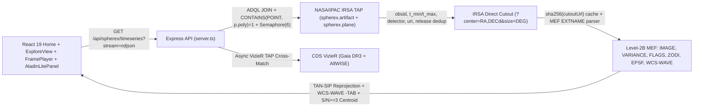

# SPHEREx: The Changing Sky (`SPEX`)

**NASA Space Apps Challenge 2026** — A public multi-epoch astronomical blink, subpixel proper-motion tracker, and `-TAB` LVF spectro-photometric explorer powered by live **NASA/IPAC IRSA SPHEREx (`spherex.artifact` JOIN `spherex.plane`)** Level-2B FITS cutouts.

---

## Official Data Sources & Reference UX

- **SPHEREx at IRSA:** https://irsa.ipac.caltech.edu/Missions/spherex.html
- **IRSA SPHEREx Tutorial Notebooks:** https://caltech-ipac.github.io/irsa-tutorials/spherex/
- **WiseView (Reference Flipbook UX):** http://byw.tools/wiseview
- **Gaia DR3 (Latest Astrometric Catalog):** https://archive.stsci.edu/missions-and-data/gaia

---

## Key Capabilities & Comparison to WiseView

| Feature | WiseView (NEOWISE) | SPHEREx: The Changing Sky |
| :--- | :--- | :--- |
| Multi-epoch flipbook & blink | Epoch flipbook & blink | Progressive multi-epoch flipbook (10–20 frames) across all available releases (`dr1`/`qr3`/`qr2`) + `Blink 1↔Last` + keyboard shortcuts (`Space`, `←`, `→`, `L`, `B`) |
| Progressive disclosure | Single flat toolbar | Clean primary toolbar (`Normal` / `Show changes`, Play/Pause, Speed, `D1–D6` detector selector) + collapsed `Advanced` drawer |
| Intensity scaling | Adjustable contrast | Global per-band `p02–p98` percentile stretch (eliminates flicker) + optional `Per-Frame Auto`, `asinh/linear/sqrt/log` stretches |
| Moving-object astrometry | Reticle + blinking | SIMBAD/Spitzer/Gaia PM propagation, sky-frame motion trail, differential Gaia DR3 (`\|pm\| < 20 mas/yr`) frame alignment, stationary-control **astrometric floor** (`3×` significance gate), and `VARIANCE`+`FLAGS`-gated **Measured Centroid vs Time** SVG plot |
| Image arithmetic | Epoch diff toggle | `Normal` (`Raw`), `Show changes` (`Diff vs Ep 1`), `Diff vs Median`, and inverse-variance weighted `Co-add Stack` strictly within same `release` + `VERSION` |
| Spectral & detector bands | W1 (3.4 µm), W2 (4.6 µm) | Live `D1–D6` detector switcher (`0.75–5.0 µm`) + exact `WCS-WAVE` `-TAB` evaluation per pixel + `wlWindow` filter + 102 LVF channel inspector |
| Catalog & sky context | Gaia/WISE linkouts | Live CDS VizieR `Gaia DR3` (propagated from epoch `2016.0` to exposure epoch) & `AllWISE` overlays (note: ultra-cool Y-dwarfs like WISE 0855 rely on Spitzer/HST and are absent from optical Gaia DR3) + pinned interactive `Aladin Lite v3` |
| URL sharing & Bilingual UI | Query string state | Deep links (`?target=`, `?ra=&dec=`, `?band=`, `?fov=`), PNG snapshot/Discovery Postcard, EN/AR bilingual UI |

---

## Live Architecture & Data Flow



---

## The 5 Benchmark Targets (One-Click Deep Links)

1. **Barnard's Star (GJ 699)** (M4V, ~10.39″/yr Gaia DR3 PM; bright core saturates `0x02` in short/mid SPHEREx bands): `/?target=barnards-star&band=D3`
2. **Epsilon Indi Ba/Bb** (Binary T1+T6 brown dwarf, ~4.71″/yr PM; measured `D3` over 517d): `/?target=epsilon-indi&band=D3`
3. **WISE 0855-0714** (Coldest Y-dwarf ~250 K, ~8.15″/yr Spitzer/HST PM; detected in `D5` `3.8–4.4 µm`, excluding 7.9″ Gaia field star): `/?target=wise-0855&band=D5`
4. **RW Aurigae** (Classical T Tauri YSO stationary control; empirically calibrates astrometric floor in `D1`): `/?target=rw-aurigae&band=D1`
5. **R Draconis** (Mira-type AGB pulsating giant stationary control; extreme NIR brightness saturates core): `/?target=r-draconis&band=D6`

---

## Updating for Future IRSA SPHEREx Data Releases (Zero Code Changes)

When NASA/IPAC IRSA publishes new data drops or all-sky releases:

1. Configure environment variables (see `.env.example` and `docs/DATA_DROP_RUNBOOK.md`):
   - `SPHEREX_IRSA_HOST` (default: `https://irsa.ipac.caltech.edu`)
   - `SPHEREX_ARTIFACT_TABLE` (default: `spherex.artifact`)
   - `SPHEREX_PLANE_TABLE` (default: `spherex.plane`)
   - `SPHEREX_RELEASE_PREFERENCE` (default: `dr1,qr3,qr2` — newest release listed first for automatic deduplication)
2. Verify live TAP connectivity, `availableReleases`, and the newest observation MJD (`MAX(p.time_bounds_upper)`) via:
   ```bash
   curl http://localhost:3000/api/health
   ```

---

## Scientific Notes & Known Limitations

- **Differential Astrometry & Empirical Error Floor (Limitation):** At SPHEREx's native `6.2″/pixel` plate scale, absolute per-exposure WCS residuals and subpixel aperture centroiding cannot rely on raw headers alone. SPEX aligns each cutout against isolated Gaia DR3 field stars (`|pm| < 20 mas/yr`, ≥ 3 px separation, sigma-clipped translation or constrained affine when ≥ 6 stars exist; frames with < 3 stars are flagged `low confidence`), rejects apertures with DQ saturation/overflow (`0x02`) or non-functional (`0x10`) bits, rejects blended non-isolated peaks or closer catalog neighbors within `15″`, and calibrates the **astrometric floor** (`~0.44″` RMS) from stationary controls (`RW Aur`, `R Dra`). Displacements `≤ 3×` this floor are reported honestly as `"motion not significant"`. Very bright targets (`Barnard's Star`, `R Dra`) frequently saturate the `0x02` detector full-well in Level-2B cutouts and are flagged `"not detected in D<n>"` rather than emitting corrupted centroids.
- **Empirical PSF (`EPSF` Extension):** Level-2B SPHEREx MEF cutouts include a `BINTABLE` `EPSF` extension storing the empirical PSF across detector position and wavelength. `FITSReader` parses and preserves `EPSF` metadata; however, current centroiding and center-aperture spectrophotometry use variance- and DQ-flag-weighted aperture sums rather than full 2D forward-model ePSF profile fitting (planned under Future Work).
- **LVF Spatial-Spectral Coupling:** Each pixel across a SPHEREx exposure samples a slightly shifted LVF wavelength (`WCS-WAVE` `-TAB`); when plotting spectra spanning `> 0.3 µm` or multiple detectors, the UI displays an explicit caveat noting spectral slope across LVF channels.

---

## Future Work

- Splitting `server.ts` into modular route and pipeline service modules (`src/server/routes/*`, `src/server/tapClient.ts`).
- Animated GIF / MP4 blink-sequence and time-lapse movie export directly from `FramePlayer`.
- Full 2D `EPSF` BINTABLE forward-modeling photometry for crowded fields and blended binaries (such as resolving sub-arcsecond Epsilon Indi Ba/Bb components).
- Automated multi-epoch shift-and-stack orbital search for Solar System NEOs and faint moving asteroids.
- Persistent browser workspace bookmarks for custom discovered transient candidates.

---

## Setup, Run, Test & Cloud Run Deployment

```bash
npm install
npm run dev       # Express + Vite middleware on http://localhost:3000
npm run build     # Vite production bundle + esbuild server.js
npm start         # Production server (node server.js, respects $PORT)
npm run lint      # TypeScript type-check (tsc --noEmit)
npm test          # Full unit test suite
npm run data-drop-check                             # Live IRSA TAP readiness per official target
npx tsx scripts/build_snapshot.ts                   # Refresh compact (<3 MB) archive snapshots
npx tsx --test src/science/irsaIntegration.test.ts  # Live IRSA TAP + direct cutout + WCS-WAVE test
node scripts/e2e_smoke.mjs                          # Headless Chromium smoke test
```

---

## Data Attribution & Non-Endorsement

Data: NASA/IPAC IRSA SPHEREx, ESA Gaia DR3, NASA AllWISE, CDS SIMBAD & Aladin Lite. NASA does not endorse this project.
