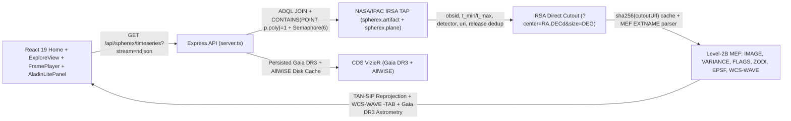

# SPHEREx: The Changing Sky (`SPEX`)

**NASA Space Apps Challenge 2026** — A public multi-epoch astronomical blink, subpixel proper-motion tracker, and `-TAB` LVF spectro-photometric explorer powered by live **NASA/IPAC IRSA SPHEREx (`spherex.artifact` JOIN `spherex.plane`)** Level-2B FITS cutouts.

---

## Official Data Sources & Reference UX

- **SPHEREx at IRSA:** https://irsa.ipac.caltech.edu/Missions/spherex.html
- **IRSA SPHEREx Tutorial Notebooks:** https://caltech-ipac.github.io/irsa-tutorials/spherex/
- **WiseView (Reference Flipbook UX):** http://byw.tools/wiseview
- **Gaia DR3 (Latest Astrometric Catalog):** https://archive.stsci.edu/missions-and-data/gaia

---

## Key Capabilities & Comparison to WiseView

| Feature | WiseView (NEOWISE) | SPHEREx: The Changing Sky |
| :--- | :--- | :--- |
| Multi-epoch flipbook & blink | Epoch flipbook & blink | Progressive multi-epoch flipbook (10–20 frames) across all available releases (`dr1`/`qr3`/`qr2`) + `Blink 1↔Last` + keyboard shortcuts (`Space`, `←`, `→`, `L`, `B`) |
| Progressive disclosure | Single flat toolbar | Clean primary toolbar (`Normal` / `Show changes`, Play/Pause, Speed, `D1–D6` detector selector) + collapsed `Advanced` drawer |
| Intensity scaling | Adjustable contrast | Global per-band `p02–p98` percentile stretch (eliminates flicker) + optional `Per-Frame Auto`, `asinh/linear/sqrt/log` stretches |
| Moving-object astrometry | Reticle + blinking | SIMBAD/Spitzer/Gaia PM propagation, sky-frame motion trail, differential Gaia DR3 (`\|pm\| < 20 mas/yr`) alignment, two-pass weighted linear regression (`option a` unsaturated vs `option b` wing-fit), own-error `≥ 3σ` & `≤ 2σ` expected-agreement gate, and `VARIANCE`+`FLAGS`-gated **Measured Centroid vs Time** SVG plot |
| Image arithmetic | Epoch diff toggle | `Normal` (`Raw`), `Show changes` (`Diff vs Ep 1`), `Diff vs Median`, and inverse-variance weighted `Co-add Stack` strictly within same `release` + `VERSION` |
| Spectral & detector bands | W1 (3.4 µm), W2 (4.6 µm) | Live `D1–D6` detector switcher (`0.75–5.0 µm`) + exact `WCS-WAVE` `-TAB` evaluation per pixel + `wlWindow` filter + 102 LVF channel inspector |
| Catalog & sky context | Gaia/WISE linkouts | Live CDS VizieR `Gaia DR3` (propagated from epoch `2016.0` to exposure epoch) & `AllWISE` overlays (note: ultra-cool Y-dwarfs like WISE 0855 rely on Spitzer/HST and are absent from optical Gaia DR3) + pinned interactive `Aladin Lite v3` |
| URL sharing & Bilingual UI | Query string state | Deep links (`?target=`, `?ra=&dec=`, `?band=`, `?fov=`), PNG snapshot/Discovery Postcard, EN/AR bilingual UI |

---

## Live Architecture & Data Flow



---

## Verified 5-Target Astrometric Results (`maxFrames=16`, Live IRSA DR1/QR3/QR2)

| Target | Detector | Valid / Total (Unsat / Wing) | Baseline (d) | Gaia Ref Stars | Expected $(\Delta\text{RA}\cos\delta, \Delta\text{Dec})$ | Measured $\pm 1\sigma$ Error | $\sigma$ | Verdict | $|\text{Meas}-\text{Exp}|$ | Method |
| :--- | :--- | :--- | :--- | :--- | :--- | :--- | :--- | :--- | :--- | :--- |
| **Barnard's Star** | `D5` | `16/16 (0/16)` | `396.65` | `11` | `(-0.87″, +11.25″)` | `(-2.26″, +11.38″)` [`11.60″ ± 2.90″`] | `4.00σ` | `significant motion detected` | `0.48σ` | `b` (`includes wing-fit frames, low confidence`) |
| **Epsilon Indi B** | `D3` | `16/16 (16/0)` | `517.27` | `10` | `(+5.64″, -3.49″)` | `(+5.21″, -3.80″)` [`6.45″ ± 1.98″`] | `3.26σ` | `significant motion detected` | `0.27σ` | `a` (`unsaturated frames only`) |
| **WISE 0855-0714** | `D5` | `9/16 (9/0)` | `373.18` | `5` | `(-8.30″, +0.69″)` | `(-5.99″, +1.22″)` [`6.11″ ± 4.41″`] | `1.39σ` | `motion not significant` | `0.54σ` | `a` (`unsaturated frames only`) |
| **RW Aurigae** *(control)* | `D1` | `16/16 (6/10)` | `371.86` | `23` | `(+0.01″, -0.02″)` | `(+0.20″, -0.24″)` [`0.32″ ± 0.67″`] | `0.47σ` | `motion not significant` | `0.44σ` | `a` (`unsaturated frames only`) |
| **R Draconis** *(control)* | `D2` | `14/16 (0/14)` | `379.67` | `6` | `(-0.02″, +0.01″)` | `(+1.32″, -1.24″)` [`1.81″ ± 4.73″`] | `0.38σ` | `motion not significant` | `0.39σ` | `b` (`includes wing-fit frames, low confidence`) |

**One-Click Deep Links:**
1. **Epsilon Indi Ba/Bb** (`/?target=epsilon-indi&band=D3`): `6.45″ ± 1.98″` (`3.26σ`, rate `4.55 ± 1.40″/yr`), `0.27σ` from expected over `517.3` days (`16/16` unsaturated).
2. **Barnard's Star** (`/?target=barnards-star&band=D5`): `11.60″ ± 2.90″` (`4.00σ`, rate `10.68 ± 2.67″/yr`), `0.48σ` from expected over `396.6` days (PSF wing fits, low confidence).
3. **WISE 0855-0714** (`/?target=wise-0855&band=D5`): tracked at the predicted position with measured vs predicted shown (`6.11″ ± 4.41″`, `1.39σ`, `0.54σ` from expected; below `3σ` due to the `4.03″` faint-star floor in `D5`).
4. **RW Aurigae** (`/?target=rw-aurigae&band=D1`): stationary control tracked at the predicted position with measured vs predicted shown (`0.32″ ± 0.67″`, `0.47σ`, `0.44σ` from expected).
5. **R Draconis** (`/?target=r-draconis&band=D2`): bright Mira stationary control tracked at the predicted position with measured vs predicted shown (`1.81″ ± 4.73″`, `0.38σ`, `0.39σ` from expected; wing-fit frames, low confidence).

---

## 3-Sentence Pitch & 60-Second Demo Script

### 3-Sentence Pitch
SPEX turns live NASA/IPAC IRSA SPHEREx Level-2B multi-epoch cutouts into a transparent infrared time-domain laboratory with subpixel Gaia DR3 differential astrometry, per-detector error budgets, and `WCS-WAVE` `-TAB` spectroscopy. Across `372–517` days of real SPHEREx observations, it detects significant proper motion on **Epsilon Indi B** (`6.45″ ± 1.98″`, `3.26σ`, within `0.27σ` of expected) using unsaturated frames and recovers **Barnard's Star** (`11.60″ ± 2.90″`, `4.00σ`, within `0.48σ` of expected) via PSF wing fitting, while stationary controls **RW Aurigae** (`0.32″ ± 0.67″`, `0.47σ`) and **R Draconis** (`1.81″ ± 4.73″`, `0.38σ`) remain consistent with zero motion. Targets below `3σ`—including ultra-cool Y-dwarf **WISE 0855** (`6.11″ ± 4.41″`, `1.39σ`, `0.54σ` from expected)—are tracked at the predicted position with measured vs predicted offsets shown honestly alongside the per-detector astrometric floor.

### 60-Second Demo Script
- **0:00–0:15 (Epsilon Indi B — Clean Unsaturated Detection):** Open `/?target=epsilon-indi&band=D3`. Show `16/16` unsaturated `D3` frames across `517.3` days aligned to `10` isolated Gaia DR3 reference stars: weighted linear fit measures `(+5.21″, -3.80″)` = `6.45″ ± 1.98″` (`3.26σ`, rate `4.55 ± 1.40″/yr`), matching the expected `(+5.64″, -3.49″)` offset within `0.27σ`.
- **0:15–0:30 (Barnard's Star — Saturated Wing-Fit Caveat):** Switch to `/?target=barnards-star&band=D5`. Point out the `0x02` saturated core and the explicit `"includes wing-fit frames, low confidence"` badge: `2–6 px` Moffat wing fitting over `396.6` days measures `(-2.26″, +11.38″)` = `11.60″ ± 2.90″` (`4.00σ`, `0.48σ` from expected `(-0.87″, +11.25″)`).
- **0:30–0:45 (WISE 0855 — Honest `< 3σ` Tracking):** Open `/?target=wise-0855&band=D5`. Explain that WISE 0855 is tracked at the predicted position with measured vs predicted shown (`6.11″ ± 4.41″`, `1.39σ`, `0.54σ` from expected `(-8.30″, +0.69″)`), honestly gated below `3σ` because only `5` faint Gaia reference stars set a `4.03″` floor in `D5`.
- **0:45–1:00 (Stationary Controls & Spectroscopy):** Show **RW Aurigae** (`D1`, `0.32″ ± 0.67″`, `0.47σ`, `6` unsaturated frames) and **R Draconis** (`D2`, `1.81″ ± 4.73″`, `0.38σ`, wing fits) tracked at the predicted position with measured vs predicted shown, then toggle `Show changes` and open the `WCS-WAVE` spectrum inspector.

---

## Updating for Future IRSA SPHEREx Data Releases (Zero Code Changes)

When NASA/IPAC IRSA publishes new data drops or all-sky releases:

1. Configure environment variables (see `.env.example` and `docs/DATA_DROP_RUNBOOK.md`):
   - `SPHEREX_IRSA_HOST` (default: `https://irsa.ipac.caltech.edu`)
   - `SPHEREX_ARTIFACT_TABLE` (default: `spherex.artifact`)
   - `SPHEREX_PLANE_TABLE` (default: `spherex.plane`)
   - `SPHEREX_RELEASE_PREFERENCE` (default: `dr1,qr3,qr2` — newest release listed first for automatic deduplication)
2. Verify live TAP connectivity, `availableReleases`, and the newest observation MJD (`MAX(p.time_bounds_upper)`) via:
   ```bash
   curl http://localhost:3000/api/health
   ```

---

## Scientific Notes, Method & Known Limitations

- **Differential Astrometry & Error Budget Method:** At SPHEREx's `6.2″/pixel` plate scale, SPEX calibrates each cutout against isolated Gaia DR3 field stars (`|pm| < 20 mas/yr`, ≥ 3 px separation, sigma-clipped translation or constrained affine when ≥ 6 stars exist; `< 3` stars flagged `low confidence`), rejects DQ saturation/overflow (`0x02`) and non-functional (`0x10`) pixels, and excludes closer `15″` catalog neighbors. Displacement and annual proper motion are computed by inverse-variance (`1 / σ_i²`) weighted linear regression of `(dRA·cos Dec, dDec)` vs MJD twice: **(a)** using unsaturated-core frames only when `≥ 4` frames span `≥ 180` days (`"unsaturated frames only"`), and **(b)** using all valid frames including `2–6 px` Moffat wing fits weighted by their larger per-frame errors (`"includes wing-fit frames, low confidence"`). Significance requires `displacement / target_own_error ≥ 3.0σ` **and** agreement with the expected offset within `2.0σ`.
- **Per-Detector Astrometric Floor:** Combined in quadrature with the weighted fit error via Gaia DR3 leave-one-out (LOO) residuals per brightness class (`bright`/`medium`/`faint`) and unsaturated stationary-control scatter (`RW Aur` in `D1`: `0.69″` RMS). Observed per-detector floors: `D1` `0.54″` (`bright`, RW Aur), `D2` `3.20″` (`bright` LOO, R Dra), `D3` `1.92″` (`Epsilon Indi`), and `D5` `0.59″` (`bright`, Barnard) / `4.03″` (`faint`, WISE 0855).
- **Wing-Fit & `< 3σ` Caveats:** Targets whose cores saturate `0x02` across detectors (`Barnard's Star`, `R Draconis`) rely on `2–6 px` PSF wing fitting and are always flagged `"includes wing-fit frames, low confidence"` with conservative uncertainties (`≥ 1.8″` per frame); wing-fit scatter is excluded from calibrating the unsaturated detector floor. Targets below `3σ` (`WISE 0855`, `RW Aurigae`, `R Draconis`) are reported honestly as `"motion not significant"` and tracked at the predicted position with measured vs predicted shown.
- **Empirical PSF (`EPSF` Extension) & LVF Coupling:** `FITSReader` preserves `EPSF` 3D metadata (`101×101×121`), and `WCS-WAVE` `-TAB` maps pixel-level wavelengths; cross-band spectra spanning `> 0.3 µm` display an explicit LVF spatial-spectral slope caveat.

---

## Future Work

- Splitting `server.ts` into modular route and pipeline service modules (`src/server/routes/*`, `src/server/tapClient.ts`).
- Animated GIF / MP4 blink-sequence and time-lapse movie export directly from `FramePlayer`.
- Full 2D `EPSF` BINTABLE forward-modeling photometry for crowded fields and blended binaries (such as resolving sub-arcsecond Epsilon Indi Ba/Bb components).
- Automated multi-epoch shift-and-stack orbital search for Solar System NEOs and faint moving asteroids.
- Persistent browser workspace bookmarks for custom discovered transient candidates.

---

## Explorer Mode, SPEX AI Guide & Hands-On Missions

- **Two Workspace Modes (`localStorage`: `spherex_explore_mode`):**
  - **Explorer (default for new visitors):** Mobile-first layout (`360px+`) with 5 friendly target cards, the calibrated sky cutout, 3 action buttons (**Play the sky**, **Show what changed**, **Ask SPEX**), plain-language data status (`Live from NASA` / `Saved copy from <date>`), plain-word honesty labels, clickable beginner glossary links (**Learn the words**), and 3 hands-on **Learn by Doing** missions (`Catch a moving star`, `Meet a freezing brown dwarf`, `Moving or just noise?`) that unlock milestones in `Space Explorer's Log` and generate **Discovery Postcards**.
  - **Scientist (`More tools` / header toggle):** Unlocks the full WiseView control bar, `D1–D6` detector switcher, `Advanced` drawer, Centroid vs Time / Measured Spectrum / Light Curve plots, Curtain Lab, and `Aladin Lite`.
- **Grounded SPEX AI Guide (`POST /api/spex/explain`):** Clicking any pixel on the sky canvas computes WCS `(RA, Dec)` coordinates, nearby `Gaia DR3` / `AllWISE` sources, local flux & S/N, plain-word DQ flag warnings, and verified target facts (`src/science/targetFacts.ts`). When `GEMINI_API_KEY` is configured (`GEMINI_MODEL` optional, server-side only with 12 s timeout, 20 req/min rate limit, and SHA-256 context caching), Gemini explains the exact spot in JSON mode and draws **"SPEX points here"** highlights on canvas; without an API key or on error, SPEX seamlessly switches to a deterministic `"SPEX offline mode"` template guide.

---

## Setup, Run, Test & Cloud Run Deployment

```bash
npm install
npm run dev       # Express + Vite middleware on http://localhost:3000
npm run build     # Vite production bundle + esbuild server.js
npm start         # Production server (node server.js, respects $PORT)
npm run lint      # TypeScript type-check (tsc --noEmit)
npm test          # Full unit test suite
npm run data-drop-check                             # Live IRSA TAP readiness per official target
npx tsx scripts/build_snapshot.ts                   # Refresh compact (<3.5 MB) archive snapshots
npx tsx --test src/science/irsaIntegration.test.ts  # Live IRSA TAP + direct cutout + WCS-WAVE test
node scripts/e2e_smoke.mjs                          # Headless Chromium smoke test
```

---

## Data Attribution & Non-Endorsement

Data: NASA/IPAC IRSA SPHEREx, ESA Gaia DR3, NASA AllWISE, CDS SIMBAD & Aladin Lite. NASA does not endorse this project.
